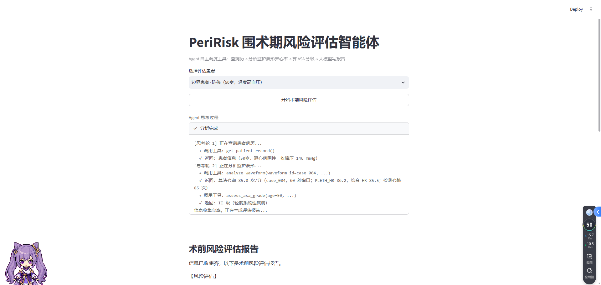
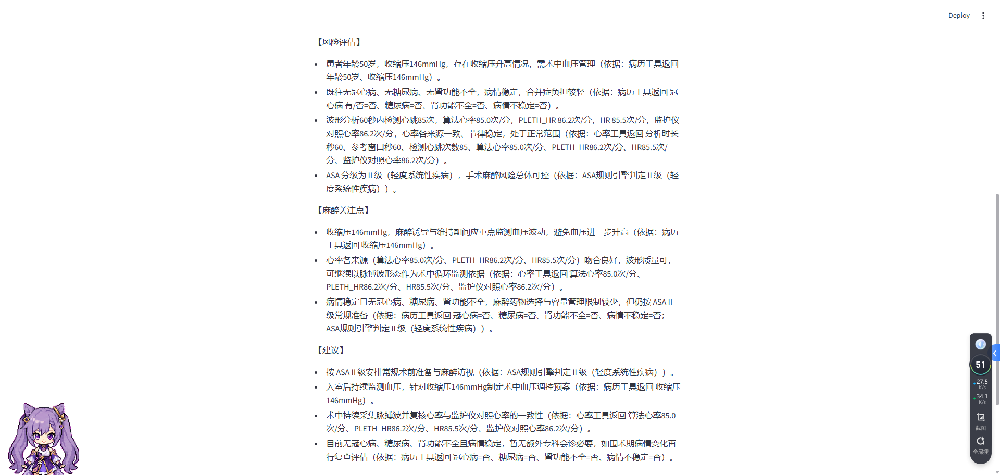

# PeriRisk Agent

围术期风险评估演示项目。输入患者的基本信息和生命体征，程序先自己算出 ASA 麻醉分级和心率，再调用 DeepSeek 大模型生成一份术前风险评估报告。

> 教学/演示用，不是医疗器械，不构成医疗建议。ASA 分级逻辑是简化版，跟临床完整标准有差异。

## 界面预览

选择患者后，Agent 自主依次调用「查病历 → 波形心率检测 → ASA 规则分级」，思考过程与每次工具返回逐条可见：

信息集齐后生成三段式报告（风险评估 / 麻醉关注点 / 建议），每条结论句末标注引用的工具返回依据：

## 怎么用

1. 装依赖：`pip install requests scipy numpy streamlit`
2. 去 DeepSeek 开放平台创建 API Key，填进 `config.py`
3. 两种入口：
   - **命令行 Agent**：`python peririsk_agent.py`（可带提示词参数）
   - **Web 界面**：`python -m streamlit run app.py`（浏览器里选患者、看思考过程和报告）
4. 离线批量评估：`python evaluate.py`（对 5 个测试病例跑 Agent，打印汇总表并导出 `evaluation_results.csv`）

`config.py` 已经被 .gitignore 排除，不要提交它，也不要在任何代码里写死 key。

## 结构

公共模块（改一处，全项目生效）：
- `asa_risk.py` — ASA 分级规则引擎（纯逻辑，不调 AI；已纳入收缩压，见下方规则）
- `patient.py` — 患者档案 + 摘要拼接；内置 5 个病例花名册 `PATIENTS`，网页与评估共用
- `llm.py` — DeepSeek 调用（提示词、模型名、接口地址都在这一处）
- `runtime_state.py` — 当前运行患者的切换状态
- `tools/` — 三个工具的本地实现、JSON Schema 和注册表
- `deck_output/PeriRisk_核心参考文献_原文/references/` — 5 篇核心文献，全部附可阅读全文 PDF（XML 原文件同时保留）

主程序：
- `peririsk_agent.py` — **Agent 版（主推）**：DeepSeek 通过 function calling 自主调度工具（Agent 循环），带彩色思考过程和 loading 动画
- `app.py` — Streamlit Web 界面：选患者 → 逐行看 Agent 思考过程 → markdown 报告
- `evaluate.py` — 离线批量评估：工具调用顺序、ASA 分级一致性、心率误差，导出 CSV

数据：
- `data_cases/` — 5 个不同 VitalDB 病例的配对波形，患者与波形 ID 一一绑定

完整目录、测试、文档和比赛材料的位置见 `PROJECT_LAYOUT.md`。

## 流程

患者信息 → Agent 自主查病历、分析与患者绑定的波形心率、调用 ASA 规则引擎 → DeepSeek 写三段式报告。

三个工具：

- `get_patient_record` — 查病历（年龄、既往史、收缩压）
- `analyze_waveform` — 读患者对应病例的脉搏波，返回算法心率、PLETH_HR 与综合 HR
- `assess_asa_grade` — 规则引擎算 ASA 分级

报告里**每一条结论句末都附"（依据：…）"**，标注它引用了哪个工具的哪个返回值；模型只能引用工具真实返回的字段（字段白名单写在系统提示词里），工具没返回的信息（如性别、舒张压、造影结果）不许写，从机制上防止编造病历。

## ASA 分级规则（简化演示版）

基础规则：病情不稳定 → IV/V 级；肾衰+冠心病叠加 → IV；有冠心病或糖尿病 → III；≥65 岁健康 → II；否则 I。

血压地板（与基础级别取高，只升不降）：收缩压 ≥180 → 至少 III；140–179 → 至少 II；<140 或未提供 → 不影响。

## 后面想做的

- ASA 分级补全更多并发症维度（舒张压、靶器官损害等）
- 扩充到 20+ 个不同患者病例
- 加无袖带血压预测（PINN 方向）
- 用 JiuwenSwarm 做多 Agent 协作版
